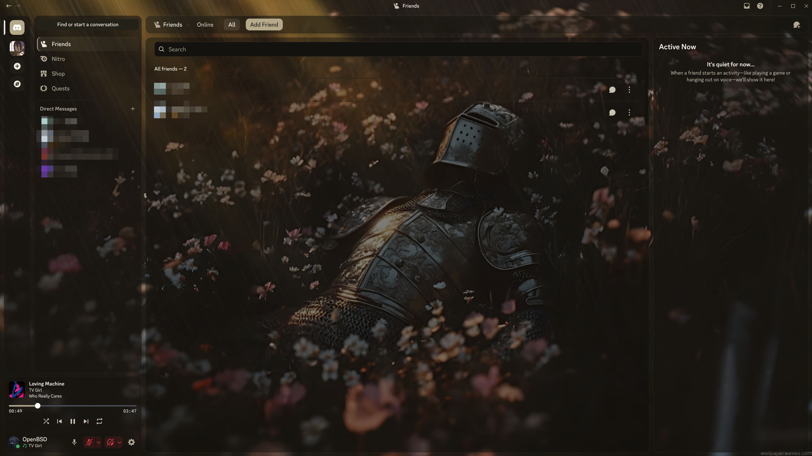

# Obsidian Fallen Knight

A dark **Vencord desktop** theme with translucent glass and a warm fallback palette. The optional **ObsidianVideo** plugin plays your own local MP4 wallpaper and adapts the interface colors to it.



*Actual Discord desktop screenshot supplied by the maintainer, showing the Friends page with the local video wallpaper. Friends' names and avatars have been pixelated for privacy; the pixelation is a screenshot edit, not a theme effect. The MP4 must be added separately.*

[Download CSS](https://github.com/opbsd/VencordTheme/releases/latest/download/Obsidian-Fallen-Knight.theme.css) · [Download theme + plugin](https://github.com/opbsd/VencordTheme/releases/latest/download/Obsidian-Fallen-Knight.zip) · [Installation guide](docs/INSTALLATION.md) · [Releases](https://github.com/opbsd/VencordTheme/releases/latest)

## Features

- Dark translucent panels, rounded corners and restrained highlights.
- Adaptive primary and secondary colors extracted locally from the wallpaper, with dark tinted surfaces and readable text.
- Small 64×36 frame samples every three seconds, gradual palette updates and no continuous full-resolution analysis.
- A fixed bronze, charcoal and ivory fallback when adaptive colors are disabled.
- Separate Friends and Active Now panels with the background visible.
- Coordinated Nitro, Shop and Quests surfaces.
- Local MP4 playback with no animated WebP or GIF conversion.
- Muted looping video, background pausing and reduced-motion support.
- Large panels avoid continuous blur over the video.

## Installation

The CSS theme works without the video plugin and uses a dark fallback background. Start with the instructions for your operating system:

- **[Windows — PowerShell](docs/INSTALLATION.md#windows)**
- **[macOS — Terminal](docs/INSTALLATION.md#macos)**
- **[Linux — distribution families, native packages and Flatpak](docs/LINUX.md)**

The [installation guide](docs/INSTALLATION.md) covers the CSS theme, building the optional desktop plugin, where to put the MP4, restarting Discord and troubleshooting. Video playback requires a custom Vencord desktop build; copying TypeScript into the themes folder does not install a plugin.

For **Online Themes**, use:

```text
https://raw.githubusercontent.com/opbsd/VencordTheme/main/Obsidian-Fallen-Knight.theme.css
```

## Local wallpaper

Name your file **`wallpaper.mp4`** and place it in the folder opened by **Settings → Vencord → Themes → Open Themes Folder**. The plugin reads only that named local file and does not upload it. When upgrading from an earlier release, rename your existing video to **`wallpaper.mp4`**, rebuild/install the updated plugin, and fully quit and reopen Discord.

The original look was inspired by **Fallen Knight in Flower Field Rain Live Wallpaper**, obtained from [Wallpaper Waves](https://wallpaperwaves.com/). Video files and standalone wallpaper assets are not bundled; the README includes a preview screenshot. You can use another MP4 that you have permission to use.

The player preserves the source video's resolution and frame rate. A 1080p/60 fps source remains 1080p/60 fps; actual presentation performance depends on your computer, decoder and workload. No frame interpolation or upscaling is performed.

## Customization

With the updated plugin, **adaptiveColors** is enabled by default. It coordinates accents, buttons, selections, borders and glass surfaces with the video's main and secondary colors. Open **Vencord → Plugins → ObsidianVideo → settings** and disable **adaptiveColors** to restore the fixed palette or use manual colors. Status, warning and danger colors remain recognizable. Analysis stays local and pauses while the document is hidden or reduced motion is enabled. Minimizing and restoring the window retains the established palette, including when the video decoder reloads its frame data; normal gradual updates resume on the sampling timer.

Edit `--obs-accent`, `--obs-text`, `--obs-gap` and `--obs-radius` near the top of the CSS. The final Fallen Knight section defines `--obs-chat-surface` and `--obs-matte-background`: increase their opacity percentages for darker panels.

The plugin can be disabled in **Vencord → Plugins → ObsidianVideo**. When the video is unavailable or reduced motion is enabled, the dark fallback remains visible.

## Compatibility and testing

The source targets **Vencord on Discord desktop**. Setup instructions are provided for Windows, macOS and Linux; runtime testing has been performed on Linux/Chromium, not independently on all three operating systems. Other clients and the browser extension have not been verified for this native plugin. The plugin does not run in Discord's Android/iOS apps.

Vencord development builds, TypeScript checking and plugin lint passed during development. The player was tested with an original 1920×1080/60 fps MP4, including start/stop, visibility changes, reduced motion and missing-file fallback. Friends, Nitro, Shop and Quests layouts were checked in simulated previews at three viewport widths. The preview above is a real desktop screenshot supplied by the maintainer; the layout checks described here used separate simulated fixtures.

Adaptive colors were checked with purple, blue, multicolor and neutral samples, including text contrast on opaque theme surfaces. A 2560×1440/60 fps MP4 ran at about 60 fps with and without sampling in a headless Chromium check; this is not a guarantee of desktop performance. Toggle restoration, hidden/reduced-motion pausing, cleanup and missing-video fallback were checked.

Discord may change its CSS classes. Report styling issues with your client version and a screenshot that excludes private information.

## License and credits

Theme and plugin code: **GPL-3.0-or-later**; see [LICENSE](LICENSE). Created by [opbsd](https://github.com/opbsd).

The plugin uses [Vencord](https://github.com/Vendicated/Vencord). This is an independent project, not affiliated with Discord or Vencord.

Third-party wallpaper rights remain with their respective owners and are not covered by the code license. Obtain and use media according to its provider's terms. The README preview is a maintainer-provided screenshot. Third-party artwork and avatars visible in it retain their respective rights.
